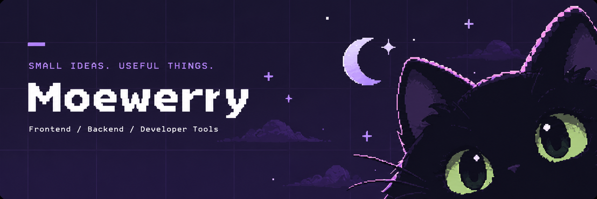

  

我主要写前端，也做一些后端和桌面工具。

## 最近做的东西

- **[LineNest](https://github.com/Moewerry/LineNest)** — 在浏览器里画线分图、复用模板、批量裁剪，图片在本地处理。[在线使用](https://moewerry.github.io/LineNest/)
- **[VoidCSV](https://github.com/Moewerry/VoidCSV)** — CSV / XLSX 文件查看器，支持小文件预览和大文件渐进索引。
- **[ConchPort](https://github.com/Moewerry/ConchPort)** — 查询 Windows 端口占用，查看对应进程并释放端口。

## 常用技术

  
  
  
  

  
  
  
  
  

## 最近的提交

  <picture>
    <source media="(prefers-color-scheme: dark)" srcset="https://raw.githubusercontent.com/Moewerry/Moewerry/output/github-contribution-grid-snake-dark.svg">
    <source media="(prefers-color-scheme: light)" srcset="https://raw.githubusercontent.com/Moewerry/Moewerry/output/github-contribution-grid-snake.svg">
    
  </picture>

