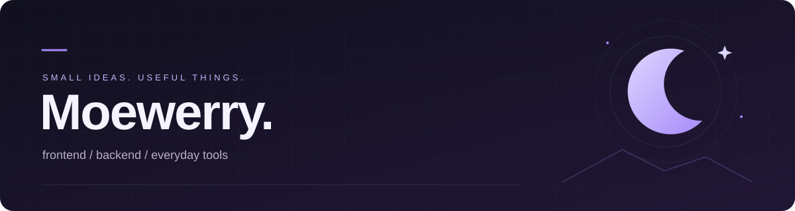
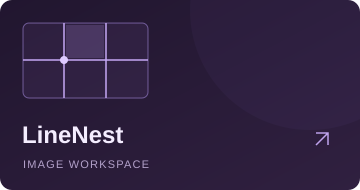
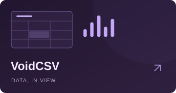

  

  <b>把小想法，做成顺手的工具。</b> 
  Frontend &amp; backend · Web tools · Desktop apps

  <a href="https://github.com/Moewerry?tab=repositories">探索项目 ↗</a>
  &nbsp;&nbsp;·&nbsp;&nbsp;
  <a href="https://moewerry.github.io/LineNest/">试用 LineNest ↗</a>

 

### 01 &nbsp; / &nbsp; SELECTED WORK
一些从实际需求出发的小作品。

 

<table>
  <tr>
    <td width="33%" valign="top">
      
        
      <b>LineNest</b> 
      画线分图、模板复用、批量裁剪。 图片在本地处理，创作留在浏览器。
        
      <a href="https://moewerry.github.io/LineNest/"><b>在线使用 ↗</b></a>
    </td>
    <td width="33%" valign="top">
      
        
      <b>VoidCSV</b> 
      CSV / XLSX 文件查看器。 小文件前端预览，大文件渐进索引。
        
      <a href="https://github.com/Moewerry/VoidCSV"><b>查看仓库 ↗</b></a>
    </td>
    <td width="33%" valign="top">
      
        
      <b>ConchPort</b> 
      Windows 端口占用查询与释放。 查看进程，释放被占用的端口。
        
      <a href="https://github.com/Moewerry/ConchPort"><b>查看仓库 ↗</b></a>
    </td>
  </tr>
</table>

 

### 02 &nbsp; / &nbsp; TOOLBOX
这些项目背后用到的技术。

 

<code>TypeScript</code> &nbsp; <code>JavaScript</code> &nbsp; <code>React</code> &nbsp; <code>Vite</code>

<code>Node.js</code> &nbsp; <code>Express</code> &nbsp; <code>Electron</code> &nbsp; <code>Docker</code> &nbsp; <code>Nginx</code>

 

### 03 &nbsp; / &nbsp; KEEP BUILDING
一点点提交，一点点把想法填满。

 

  <picture>
    <source media="(prefers-color-scheme: dark)" srcset="https://raw.githubusercontent.com/Moewerry/Moewerry/output/github-contribution-grid-snake-dark.svg">
    <source media="(prefers-color-scheme: light)" srcset="https://raw.githubusercontent.com/Moewerry/Moewerry/output/github-contribution-grid-snake.svg">
    
  </picture>

 

  building things, breaking things, fixing things. 
  ✦ &nbsp; Moewerry

